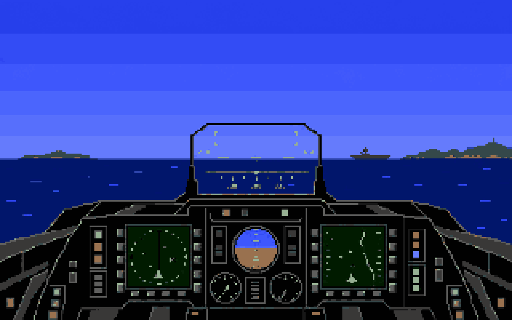

# F/A-18 Interceptor — clean-room port

[](https://github.com/st-gr/interceptor-port/actions/workflows/ci.yml)
[](https://st-gr.github.io/interceptor-port/)
[](https://github.com/st-gr/interceptor-port/releases/latest)

Take the F/A-18 or F-16 back over the Bay: carrier launches, airfield starts, flight school, carrier
qualification and all six missions, with the original flight model, cockpit, timing, weapons and sound rules.
This is a clean-room C99 port of Electronic Arts' 1988 Amiga classic, with native SDL2 builds and a WebAssembly
version. Bring your own original disk image; the project distributes no game data.

**[Play in your browser](https://st-gr.github.io/interceptor-port/)** ·
**[Download a native release](https://github.com/st-gr/interceptor-port/releases/latest)** ·
**[Read the player's manual](docs/manual.md)**



*Original abstract artwork evoking the technical limits and atmosphere of late-1980s flight simulators. This is
not a gameplay screenshot, does not show the port's real graphics, and is not derived from the original game's assets.*

The recovered rules are documented in `docs/re/`; the code in `src/` was written from those notes.

## What this is not

This repository holds no game asset: no program code of the original, no disk image, no model, picture, text,
sound or sample, and no table of the disk's bytes. The notes in `docs/re/` identify each such table by its file
name and an FNV-1a-32 hash and describe its rule (length, ordering, ranges, what an entry means); the extractor
reads the bytes from your disk. What the notes and the source do contain are the rule constants a
reverse-engineering note has to state (addresses, a few parameters per rule, formulas), and a handful of short
runs of numbers inside such rules. A clean-room scan (`tools/cleanroom`) compares the tree with the disk byte
for byte, with documented limits (see its README: short windows, runs of few distinct bytes and numbers
printed as text are not seen). To play you need your own copy of the original disk. The port
reads it at run time (the extractor in `tools/extract` for the desktop build, a JavaScript port of it in
`tools/extract-js` for the browser). Nothing of the disk is uploaded anywhere: in the browser it stays in the
page. The title and everything in its data belong to Electronic Arts.

## How to play

### Browser — quickest start

Open **[Interceptor in the browser](https://st-gr.github.io/interceptor-port/)**, drop your own disk image of the game
(an `.adf`, 901,120 bytes) on it, wait for **Ready** and click **Start**. Flux images (SCP, HFE, MFI) must be
decoded to an ADF first, for example with [Greaseweazle](https://github.com/keirf/greaseweazle):
`gw convert --format amiga.amigados disk.scp game.adf`. The flight log is kept in the browser's own storage.

### Native release — Linux, macOS or Windows

Download your platform archive from the **[latest release](https://github.com/st-gr/interceptor-port/releases/latest)**.
Each archive includes the game executable, extractor, this README and the [player's manual](docs/manual.md).
You need Python 3 and your own ADF.

Install the SDL2 runtime:

- **Windows x86_64:** nothing extra; `SDL2.dll` is included beside `interceptor.exe`.
- **Ubuntu/Debian x86_64:** `sudo apt-get install libsdl2-2.0-0`
- **macOS on Apple silicon:** install [Homebrew](https://brew.sh/), then `brew install sdl2-compat`. The binary
  is not Apple-notarized; on first launch, use Finder's **Open** command or approve it in Privacy & Security.

From the unpacked release directory:

```sh
python3 -m pip install -e tools/extract
python3 -m extract /path/to/interceptor.adf assets
./interceptor                 # Windows: interceptor.exe
```

The extractor writes only to the local `assets/` directory. Keep the executable and that directory together.

### Build from source

You need a C99 compiler, SDL2 development files, make and Python 3.

    pip install -e tools/extract
    python -m extract your-disk.adf assets      # assets/ is git-ignored; never commit it
    make                                        # build/interceptor
    build/interceptor                           # the credits, then the menu
    build/interceptor --start-keys              # the same path with the keys sent for you
    make core test                              # the unit tests, no assets needed
    make golden                                 # scripted runs against tests/golden (the synthetic ones need no assets)
    make web                                    # the browser build in build/web (needs Emscripten)

The **[player's manual](docs/manual.md)** covers every screen, control, lesson, qualification and mission.
`docs/browser-checklist.md` lists the checks only a person in a real browser can make.

## Status

| Milestone | Content | State |
| --- | --- | --- |
| 1 | Tooling and skeleton: disk decoding, the extractor, the relocated program image, the 68000 comparison rig | done |
| 2 | The world: terrain, objects, the display-list builder and the draw layer | done |
| 3 | Flight: the flight model, take-off, landing, crash rules, cockpit, HUD, sky, ground | done |
| 4 | Game flow: the start screens, menu, demonstration, flight school, carrier qualification, the flight log | done |
| 5 | Combat: cannon, missiles, radar, countermeasures, damage, ejection, the six missions, the hostile aircraft | done |
| 6 | Sound (the original's sound library as a model, the Paula mixer) and the browser build with the in-browser extractor | done |
| 7 | Closure and release: the remaining open rules, the clean-room scan, this export | this release |

## Releases

Maintainers cut a native binary release from GitHub's **Actions → release → Run workflow** page. Enter a semantic
version without the `v` prefix, such as `1.0.0`. The workflow builds Linux x86_64, macOS arm64 and Windows x86_64
archives, writes checksums, creates the matching `v1.0.0` tag and uploads the archives to the GitHub release.

## Clean room

The code was written from notes, not from the original's bytes. `tools/cleanroom/scan.py` slides a 12-byte window
over every file of this tree and compares it with the extracted assets, the disk image and the program image of
the original. The public export runs it and stops on any match; this tree was exported with no unallowed match.
Its allow list (`tools/cleanroom/allow.txt`) names each tolerated run with a reason. The tests use invented data.
The reverse-engineering notes describe the original's rules in prose and with the port's own constants.
You can repeat the scan with your own disk: `python tools/cleanroom/scan.py --repo . --assets assets --disk
your-disk.adf --bin image.bin` (the program image `image.bin` comes from `tools/hunk/relocate.py`).

The code-wheel tooling (the decoder of the original's copy-protection wheel and its answer table, which the notes
mention as the author's private tooling) and the author's sandbox profiles are not part of this tree. The port
skips the original's security prompt.

## Licence

GPL-3.0, see `LICENSE`. The reference-emulator tooling under `tools/vamiga-ref` builds on
[vAmiga](https://github.com/dirkwhoffmann/vAmiga) (GPL-3.0) and is GPL-3 as upstream; it is tooling for checking
the notes and is not part of the port.

## Trademarks and copyright

*F/A-18 Interceptor* is a title of Electronic Arts, the game's program and data are their copyright, and the
publisher's name and the title are used here only to say what this software is compatible with. This project is
not made, endorsed or approved by Electronic Arts or any rights holder. The port contains no asset of the original
(no program code, picture, model, text, sound, sample or table of bytes); its notes and source state the rules the
original follows, with the constants those rules need. Amiga is a trademark of its respective owner.
